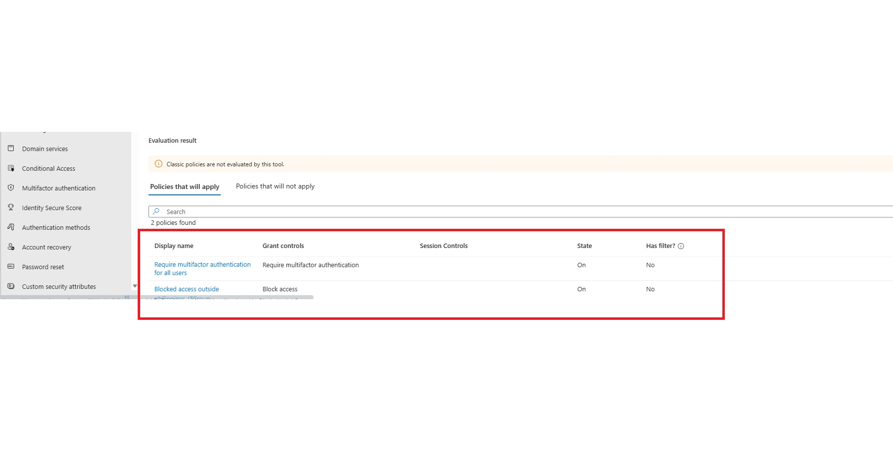

# Conditional Access Lab: IP-Based and Location-Based Policies in Microsoft Entra ID

Two hands-on Conditional Access exercises in my home lab tenant. The first requires MFA whenever a user signs in from anywhere other than my trusted home network (IP-based). The second blocks sign-ins from outside the Philippines (location-based). Both were built, simulated, and tested with real sign-ins.

> **Note:** This is a lab environment. All accounts, groups, and policies belong to a test tenant, and all sign-in tests used test users.

---

## Contents

- [Overview](#overview)
- [Starting Point](#starting-point)
- [Part 1: IP-Based Policy (Require MFA outside Home Lab)](#part-1-ip-based-policy-require-mfa-outside-home-lab)
- [Part 2: Location-Based Policy (Block access outside the Philippines)](#part-2-location-based-policy-block-access-outside-the-philippines)
- [Comparing the Two Policies](#comparing-the-two-policies)
- [What I've Learned](#what-ive-learned)
- [Troubleshooting](#troubleshooting)
- [Next Steps](#next-steps)
- [Skills Demonstrated](#skills-demonstrated)

---

## Overview

| | |
|---|---|
| **Goal** | Control where users can sign in from, using Conditional Access |
| **Platform** | Microsoft Entra ID, Conditional Access |
| **Tenant** | evilcorpLAB (lab tenant) |
| **Policy 1** | Require MFA outside Home Lab (IP-based, report-only) |
| **Policy 2** | Blocked access outside philippines_ITGroup (location-based, On) |
| **Test users** | Carmina Galvelo (IT), jaydee mamba |
| **Testing tools** | What If tool, Sign-in logs, report-only results, Proton VPN, InPrivate browser sessions |

## Starting Point

Before building anything, I reviewed what the tenant already enforced. Security defaults cannot be enabled here, because the tenant already uses Conditional Access policies. Four **Microsoft-managed policies** were already On:

- Block legacy authentication
- Multifactor authentication for Azure Management
- Multifactor authentication for admins
- Multifactor authentication for all users

That meant "require MFA for everyone" and "block legacy auth" were already covered, so I built policies that add something new: control by network and by country.

---

## Part 1: IP-Based Policy (Require MFA outside Home Lab)

**Idea:** include every network, then **exclude** my trusted home IP. MFA is required everywhere except at home. This is the classic "trusted network" pattern.

### Step 1: Create a trusted named location

1. Go to **Conditional Access > Named locations > IP ranges location**.
2. Name it `Homelab - lab -globe`.
3. Tick **Mark as trusted location**.
4. Add my home public IP as a range. A single address is written as a `/32` range, and the panel shows **1 IP range found**. The address is blurred in the screenshots.

The Named locations list now holds three entries:

- **All Compliant Network locations** (Network Access type, not trusted, not used)
- **conditional access country based** (Countries (IP), used by my location block policy in Part 2)
- **Homelab - lab -globe** (IP ranges, **Trusted: Yes**)

### Step 2: Create the policy

1. Go to **Conditional Access > Policies > New policy** and name it `Require MFA outside Home Lab`.
2. **Users:** specific users included and specific users excluded.
3. **Target resources:** All resources (formerly "All cloud apps").
4. **Network:** Any network or location (the exclusion comes next).
5. Entra shows a **"Don't lock yourself out!"** warning, because targeting all resources affects the admin portals. I kept my emergency exclusion in mind and tested in report-only first.

### Step 3: Exclude the trusted location and set report-only

1. Open **Network** (or **Conditions > Locations**) and set **Configure: Yes**.
2. **Include:** Any network or location.
3. **Exclude:** Selected networks and locations, then pick `Homelab - lab -globe`. The policy now reads **"Any network or location and 1 excluded"**.
4. **Grant:** Require multifactor authentication.
5. **Enable policy:** **Report-only**, so I can see what it would do before enforcing it.
6. Click **Save**.

### Step 4: Sign in from the home network

The **Sign-in events** view shows jaydee mamba signing in to **One Outlook Web** (resource: Office 365 Exchange Online) from the trusted home IP, which is blurred here. The **Conditional Access** column reads **Success**, and the location resolves to a Philippine town. The sign-in IP matches the trusted named location, so the policy has no reason to act on it.

### Step 5: Confirm access from home

Signing in to Outlook on the web as jaydee mamba from the home network opened the mailbox, with the welcome email from my onboarding project in the inbox. No extra MFA challenge appeared during this test.

### Step 6: Verify in the Report-only tab

Opening the sign-in's **Activity Details > Report only** tab shows how each report-only policy would have behaved. The highlighted row is the policy under test:

- **Require MFA outside Home Lab** (grant control: MFA): **Report-only: Not applied**. That's the expected result, because the sign-in came from the excluded trusted IP.
- **Compliant Device for Global Admins** (grant control: Require compliant device): **Report-only: Not applied**, because this user isn't a Global Administrator.

**Result:** the policy leaves the trusted network alone. The next step would be to sign in from a different IP, confirm the tab shows MFA as required, and then switch the policy to **On**.

---

## Part 2: Location-Based Policy (Block access outside the Philippines)

**Idea:** a country-based named location plus a **Block access** grant. Anyone in scope who signs in from outside the Philippines is stopped.

### Step 1: The policy in the policy list

The **Policies** page lists 7 policies:

- **4 Microsoft-managed policies**, all On: Block legacy authentication, MFA for Azure Management, MFA for admins, MFA for all users.
- **3 policies I created:** `Blocked access outside philippines_ITGroup` (On), `Compliant Device for Global Admins` (Report-only), and `Enforce MFA for IT group` (On).

The block policy is highlighted. It targets All resources, uses the country-based named location, and its grant control is **Block access**.

### Step 2: Simulate first, with the What If tool (user and app)

I used **What If** before any real sign-in, because a simulation can't lock anyone out:

- **User:** Carmina Galvelo
- **Target resource:** Cloud apps, then **Office 365 Exchange Online** (the app the user signs in to for Outlook)

### Step 3: What If sign-in conditions

The highlighted fields are the sign-in conditions:

- **Device platform:** Windows
- **Client app:** Browser
- **IP address:** a public IP that belongs to China
- **Country:** China

What If requires the **IP address and country to match each other**. A home IP paired with "China" would be a mismatch and an unreliable result.

### Step 4: What If result

Two policies apply to this simulated sign-in:

- **Require multifactor authentication for all users** (Microsoft-managed): Require MFA, On.
- **Blocked access outside philippines_ITGroup:** **Block access**, On.

When a Block policy and an MFA policy both apply, the block wins, so the user would never reach an MFA prompt.

### Step 5: The policy is On before the live test

Before testing for real, I checked the policy list again to confirm `Blocked access outside philippines_ITGroup` was **On**.

### Step 6: Live test through a VPN

For the real test, I connected **Proton VPN** to a **Japan** server. The VPN assigns a Japanese IP address, so Microsoft treats every sign-in as coming from outside the Philippines. The policy's **Enable policy: On**, **Grant: Block access**, and **Network: 1 included** settings are visible behind the VPN window, and the Policy ID is blurred.

### Step 7: The block screen

Signing in as `cgalvelo` in an InPrivate window shows **"You cannot access this right now."** The message explains that the sign-in was successful but doesn't meet the criteria to access the resource, for example because of a restricted browser, app, or location. This is the user-facing result of a Conditional Access block.

### Step 8: Sign-in logs show the Tokyo origin

Carmina Galvelo's **Sign-in logs** list the attempts from the VPN's IP. The red boxes mark the **Status** (Failure), the **IP address**, and the **Location**, which is geolocated to **Minato-Ku (Tokyo)**. These three rows show **error code 50126** with **Conditional Access: Not Applied**. Error 50126 means the credentials were rejected during password validation, so those attempts stopped before Conditional Access was evaluated. A sign-in that is blocked by a Conditional Access policy is logged with a different error code, **53003**. This is a good reminder to read the error code and not just the Failure status.

**Result:** the location policy blocks the user outside the Philippines, as shown by the simulation and the real VPN test.

---

## Comparing the Two Policies

| | Part 1: IP-based | Part 2: Location-based |
|---|---|---|
| **Policy name** | Require MFA outside Home Lab | Blocked access outside philippines_ITGroup |
| **Named location** | Trusted IP range (`/32`) | Countries (IP) |
| **Logic** | Include all networks, exclude the trusted IP | Block anything outside the Philippines |
| **Grant control** | Require multifactor authentication | Block access |
| **State when tested** | Report-only | On |
| **Test methods** | Home sign-in, Report-only tab | What If simulation, VPN sign-in, Sign-in logs |
| **Risk if misconfigured** | Low (adds MFA prompts) | High (can lock users out) |

---

## What I've Learned

**Concepts**
- A Conditional Access policy is an if-then rule: **assignments** (users, apps, conditions) decide when it applies, and **access controls** (grant or session) decide what happens.
- **Named locations** come in two types: IP ranges (a single address is a `/32`) and countries. Marking an IP range as **trusted** lets policies refer to it.
- The **include everything, exclude the trusted location** pattern is how "MFA outside the office" policies work.
- When several policies apply to a sign-in, they stack. **Block always beats a grant control.**
- Microsoft creates **managed policies** automatically, and security defaults cannot be enabled once a tenant uses Conditional Access.

**Practical habits**
- **Start in report-only**, then check the sign-in's **Report-only** tab before enforcing anything.
- **Simulate with What If** before real tests. The IP address and country must match each other.
- **Test real sign-ins in an InPrivate window** so cached sessions don't hide the result.
- **Read the error code in the Sign-in logs.** 50126 means bad credentials, and 53003 means a policy blocked the sign-in.
- **Protect against lockout:** keep emergency access accounts excluded from block policies, and pilot on a small group first.
- A **home IP can change**. A trusted-IP policy depends on that address staying the same, so it needs rechecking if the ISP changes it.

---

## Troubleshooting

| Issue | Cause | Fix |
|---|---|---|
| What If showed the location block as **not applying** to a user it should have blocked | The policy's included group had been deleted when I rebuilt my groups, so the policy applied to nobody | Reselect the group under **Users > Include** |
| What If result looked unreliable | IP address and country didn't match | Use an IP that belongs to the selected country |
| Failed sign-ins in the logs showed **Conditional Access: Not Applied** | The sign-in failed at credential validation (error 50126) before policies were evaluated | Read the error code, and look for 53003 for policy blocks |
| A test sign-in seemed to ignore the policy | An existing session or earlier MFA satisfied the request | Retest in a fresh InPrivate window |
| Security defaults could not be turned on | The tenant already uses Conditional Access | Use Conditional Access policies instead |

---

## Next Steps

- [ ] Add a policy that **blocks unknown IPs** for a pilot group, using the trusted named location
- [ ] Create an **emergency access account** and an exclusion group, and exclude it from every block policy
- [ ] Add **risk-based policies**: sign-in risk requires MFA, user risk requires a password change (as two separate policies)
- [ ] Add **Terms of use** acceptance for new hires, to extend the onboarding project
- [ ] Block unsupported **device platforms** and add a **sign-in frequency** session control
- [ ] Use **authentication strengths** to require phishing-resistant MFA for admins
- [ ] Switch the IP-based policy from report-only to On after testing from an outside IP

## Skills Demonstrated

Microsoft Entra ID, Conditional Access, named locations, MFA policy design, location and IP-based access control, report-only testing, What If analysis, sign-in log analysis, VPN-based testing, troubleshooting.
